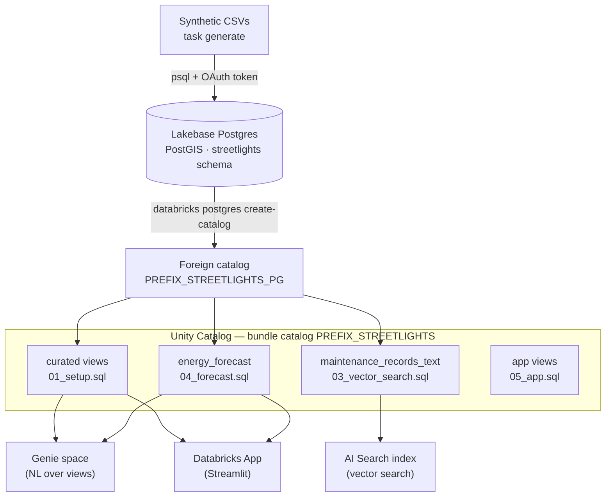

# Databricks Implementation Guide — easy start (Lakebase + Genie)

End-to-end walkthrough of the **Databricks path** of the PostGIS Data Intelligence
Demo, written for someone new to Databricks. By the end you will have:

- a **Lakebase** Postgres database with PostGIS and the synthetic streetlights data
- that database registered in **Unity Catalog** (zero-pipeline, like Snowflake's CLD)
- **curated views** in a UC schema (the Genie "semantic layer")
- a **Genie space** answering natural-language questions
- an **AI Search (Vector Search)** index over maintenance text
- an **`ai_forecast()`** energy forecast
- a **Databricks App** (Streamlit) dashboard

**Time required:** ~30–45 minutes (mostly waiting on resource provisioning).

## Architecture



| Snowflake path | This Databricks path |
|---|---|
| Snowflake Postgres + pg_lake | **Lakebase** (real Postgres 16, PostGIS native) |
| CLD (reads Iceberg metadata) | `databricks postgres create-catalog` registers the PG database in UC |
| Semantic View | curated views + Genie space instructions/verified answers |
| Cortex Search | AI Search (Vector Search) Delta Sync index |
| Intelligence Agent | **Genie** space |
| ML FORECAST | `ai_forecast()` on a serverless SQL warehouse |
| Streamlit in Snowflake | Databricks Apps (Streamlit) |

## Prerequisites

- A Databricks workspace with **Unity Catalog** (metastore attached), **Lakebase**,
  **Genie**, and **AI Search** enabled. You need privileges to create catalogs,
  SQL warehouses, and Lakebase projects (ask your workspace admin if unsure).
- Tools: `mise` (tool manager), Databricks CLI, `uv`, `psql`:

```bash
curl https://mise.run | sh        # then restart your shell
cd postgis-data-intelligence-demo
mise install                       # installs python, uv, databricks-cli
mise trust                         # allow mise to use externally installed tools
# snowflake-cli and libpq (psql) are NOT in the mise registry:
#   macOS:  brew install snowflake-cli libpq
#   Ubuntu: see https://docs.snowflake.com/en/developer-guide/snowflake-cli and apt-get install postgresql-client
uv sync
```

- Authenticate the Databricks CLI (profile-based, no tokens in files):

```bash
export DATABRICKS_HOST=https://<your-workspace>.cloud.databricks.com
databricks configure --profile default   # paste a PAT when prompted, host prefilled
# or: databricks configure --token
```

- Configure the repo: `cp .env.example .env` and set at least:

```bash
PLATFORM=databricks
DATABRICKS_HOST=https://<your-workspace>.cloud.databricks.com
DATABRICKS_PROFILE=default
DEMO_PREFIX=DEMO          # objects become DEMO_STREETLIGHTS_*
LAKEBASE_PROJECT=         # filled in at step 2
LAKEBASE_BRANCH=main
LAKEBASE_DATABASE=streetlights
DEMO_CITY=Portland
```

> Never commit `.env`. Lakebase credentials are short-lived OAuth tokens
> generated per connection (step 3), not stored anywhere.

## Step 1 — Generate the synthetic data

```bash
task generate -- --city "Portland" --prefix "DEMO"
# -> data/*.csv (7 tables, git-ignored)
```

## Step 2 — Create the Lakebase project, branch, and compute

Lakebase resources are managed with the `databricks postgres` CLI group
(check `databricks postgres --help` for exact flags):

```bash
databricks postgres create-project streetlights-demo --output json
databricks postgres create-branch projects/<project-id>/branches/main --output json
databricks postgres create-endpoint projects/<project-id>/branches/main \
  --name streetlights-compute --output json
```

(You can also do this in the workspace UI: **Apps → Lakebase Postgres**.
Pick **Autoscaling** compute.) Save the project id — the guide uses
`projects/<project-id>/branches/main` below. Set `LAKEBASE_PROJECT=<project-id>` in `.env`.

## Step 3 — Create the schema in Lakebase and load the CSVs

Lakebase speaks the standard Postgres wire protocol. Get a short-lived OAuth
token and connection details (valid 1 hour):

```bash
databricks postgres generate-database-credential \
  projects/<project-id>/branches/main/endpoints/streetlights-compute --output json
# -> {"host": ..., "port": 5432, "database": "postgres"|"streetlights", "token": ...}
```

Then, with `psql`:

```bash
export PGPASSWORD=<token-from-above>
psql -h <host> -p 5432 -U <your-databricks-identity-email> -d streetlights \
  -f databricks/sql/00_lakebase_schema.sql     # CREATE EXTENSION postgis + streetlights tables

for table in street_lights maintenance_records energy_consumption light_sensors weather_enrichment demographics power_grid_zones; do
  psql -h <host> -p 5432 -U <your-databricks-identity-email> -d streetlights \
    -c "\\copy streetlights.$table FROM 'data/${table}.csv' CSV HEADER"
done

# sanity check
psql -h <host> -p 5432 -U <your-databricks-identity-email> -d streetlights \
  -c "SELECT count(*) FROM streetlights.street_lights;"
```

## Step 4 — Register the Lakebase database in Unity Catalog (the "CLD equivalent")

```bash
databricks postgres create-catalog DEMO_STREETLIGHTS_PG \
  --json '{"spec": {"postgres_database": "streetlights",
                    "branch": "projects/<project-id>/branches/main"}}'
```

The foreign catalog `DEMO_STREETLIGHTS_PG` now exposes schema `streetlights`
with your 7 tables to any SQL warehouse, Genie, and AI Search — no data copied.

## Step 5 — Deploy the asset bundle (catalog, schema, warehouse, Genie space, jobs, app)

```bash
cd databricks
databricks bundle validate -t dev
databricks bundle deploy -t dev
```

This creates: catalog `DEMO_STREETLIGHTS`, schema `streetlights`, a
**serverless** SQL warehouse `DEMO_STREETLIGHTS_WH` (serverless is required by
`ai_forecast()`), the AI Search endpoint `DEMO_STREETLIGHTS_VS`, the **Genie
space** `DEMO_STREETLIGHTS_GENIE`, the SQL jobs, and the Databricks App
`DEMO_STREETLIGHTS_APP`. (From the repo root you can use `task dbx:validate` /
`task dbx:deploy`, which run the same commands in `databricks/`.)

## Step 6 — Run the SQL jobs

```bash
task dbx:run-all     # or from databricks/: bundle run setup -> genie_views -> vector_search -> forecast -> app
```

This builds, in `DEMO_STREETLIGHTS.streetlights`:
- `*_clean` curated views over the Lakebase catalog (`01_setup.sql`)
- verified-question views for Genie (`02_genie_space.sql`)
- `maintenance_records_text` Delta table for vector search (`03_vector_search.sql`)
- `energy_forecast` / `energy_forecast_by_neighborhood` via `ai_forecast()` (`04_forecast.sql`)
- app KPI/map views (`05_app.sql`)

## Step 7 — Create the AI Search index (UI, 2 minutes)

Vector Search indexes are created from the UI or REST API, not SQL:

1. Workspace → **AI Search** → endpoint `DEMO_STREETLIGHTS_VS` → **Create index**
2. Type: **Delta Sync**; source table:
   `DEMO_STREETLIGHTS.streetlights.maintenance_records_text`
3. Primary key: `maintenance_id`; embedding source column: `full_text` with
   model `databricks-bge-large-en` (Databricks computes embeddings); sync: TRIGGERED
4. Name: `DEMO_STREETLIGHTS.streetlights.maintenance_vs_index`

Test it in the SQL editor:

```sql
SELECT * FROM vector_search(
  index => 'DEMO_STREETLIGHTS.streetlights.maintenance_vs_index',
  query_text => 'exposed wires or sparking',
  num_results => 5);
```

## Step 8 — Configure the Genie space (UI, ~5 minutes)

The bundle created the space; now teach it:

1. Workspace → **AI/BI → Genie** → `DEMO_STREETLIGHTS_GENIE` → **Edit**
2. **Tables:** add catalog `DEMO_STREETLIGHTS`, schema `streetlights`
3. **Instructions**, e.g.:

   > You are a streetlights domain expert. Curated views: street_lights_clean,
   > maintenance_records_clean, energy_consumption_clean, weather_enrichment_clean,
   > light_sensors_clean, demographics_clean, power_grid_zones_clean. Join on
   > street_light_id. Statuses: operational | faulty | maintenance_required.
   > For maintenance text questions, use the AI Search index
   > DEMO_STREETLIGHTS.streetlights.maintenance_vs_index. When results have
   > latitude/longitude, include a map link:
   > https://www.google.com/maps/search/?api=1&query={lat},{lon}

4. **Verified answers:** add the sample questions from `databricks/sql/02_genie_space.sql`
   (e.g. "How many street lights are currently faulty?" → `SELECT * FROM v_q_faulty_count`)
5. **Sample questions** shown to users, e.g.:
   - "How many street lights are currently faulty?"
   - "Show me faulty lights in Koramangala"
   - "Which neighborhoods have the highest energy consumption?"
   - "What is the average repair cost by maintenance type?"
   - "Predict energy consumption for the next 30 days"
   - "Find maintenance reports about exposed wires or sparking"

Then chat with the space in the Genie UI.

## Step 9 — Open the dashboard app

Workspace → **Apps** → `DEMO_STREETLIGHTS_APP` → open. The app queries the
warehouse via its service principal (the bundle granted `CAN_USE` on
`DEMO_STREETLIGHTS_WH`). If `DATABRICKS_WAREHOUSE_HTTP_PATH` is not wired,
edit the app's resources to add the warehouse HTTP path
(`/sql/1.0/warehouses/<warehouse-id>`, from **SQL Warehouses →
DEMO_STREETLIGHTS_WH → Connection details**).

## Step 10 — Validate

```bash
# gate checks for the DBX path — pass --platform databricks so all Snowflake
# paths (snowflake/, snowflake gates/skills) are ignored for the run
# (needs .streetlights-demo/manifest.toml with a [databricks] section)
uv run gate --step dbx/all --action check --platform databricks
```

And run the sample questions in Genie (step 8).

## Teardown

```bash
task dbx:destroy                                          # bundle resources (app, jobs, Genie space, warehouse, schema, catalog)
databricks postgres delete-catalog DEMO_STREETLIGHTS_PG   # unregister the Lakebase DB from UC
databricks postgres delete-endpoint projects/<project-id>/branches/main/endpoints/streetlights-compute
databricks postgres delete-project projects/<project-id>  # deletes the Lakebase project + data
```

## Troubleshooting

- **`databricks bundle validate` fails on `${var...}`**: you're editing SQL outside
  the bundle — DAB interpolates `${var.prefix}` only inside bundle files. Fine.
- **ai_forecast error "requires serverless"**: the bundle warehouse must have
  `enable_serverless_compute: true` (it does); if you created a classic warehouse
  manually, recreate it as serverless.
- **Foreign catalog shows no tables**: the Lakebase compute (endpoint) must be
  running; check `databricks postgres list-endpoints`. Refresh the catalog in
  the UI — syncs trigger automatically but the UI caches.
- **psql connection refused / token expired**: OAuth tokens last 1 hour —
  regenerate with `generate-database-credential` (step 3).
- **Genie answers poorly**: add more verified answers and precise instructions;
  point it explicitly at the `*_clean` views.
- **Vector index empty**: ensure the `vector_search` job ran (the
  `maintenance_records_text` table exists) before creating the index.

## Links

- Lakebase: https://docs.databricks.com/en/oltp/
- `databricks postgres` CLI: https://docs.databricks.com/en/dev-tools/cli/reference/postgres-commands
- Register a Lakebase DB in UC: https://docs.databricks.com/en/oltp/instances/register-uc
- Asset Bundles: https://docs.databricks.com/en/dev-tools/bundles/
- Genie: https://docs.databricks.com/en/genie/
- AI Search / Vector Search: https://docs.databricks.com/en/vector-search/
- `ai_forecast()`: https://docs.databricks.com/en/sql/language-manual/functions/ai_forecast
- Databricks Apps: https://docs.databricks.com/en/dev-tools/databricks-apps/
