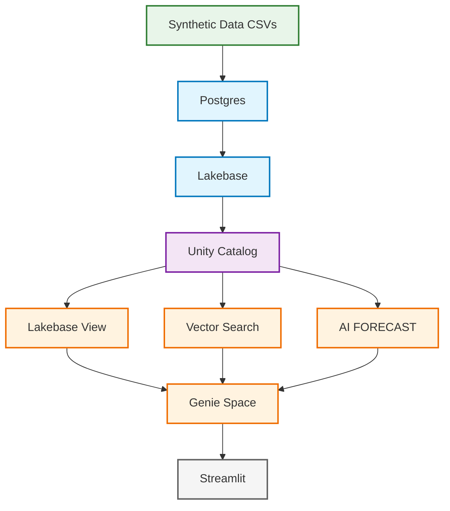
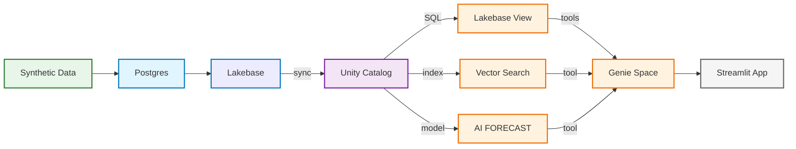

# Databricks Implementation Guide

This guide documents the Databricks implementation of the PostGIS Data Intelligence Demo. It covers architecture, setup, and execution using Lakebase and Genie.

## Quickstart

For a fast start without Cortex Code skills:

```bash
# 1. Install mise
curl https://mise.run | sh

# 2. Clone the repository
cd postgis-data-intelligence-demo

# 3. Install tools and copy environment
mise install
cp .env.databricks .env
# Edit .env with your Databricks settings

# 4. Install Databricks CLI
# See: https://docs.databricks.com/en/dev-tools/cli/index.html
mise trust

# 5. Run setup
uv run generate --city "Portland" --prefix "DEMO"

# Deploy the Databricks bundle
databricks bundle deploy -t dev

# Run all setup jobs
databricks bundle run setup
```

This completes the Databricks implementation end-to-end.

**Time required:** ~20-25 minutes

## Asset Bundle Deployment

This implementation uses Databricks Asset Bundles for resource management.

### Bundle Structure

```
databricks/
├── databricks.yml          # Bundle definition
├── sql/
│   ├── 01_setup.sql        # Catalog, schema, Lakebase sync
│   ├── 02_genie_space.sql  # Genie configuration
│   ├── 03_vector_search.sql # Vector Search index
│   ├── 04_forecast.sql     # ML forecast model
│   └── 05_app.sql          # Streamlit app deployment
└── README.md
```

### Bundle Commands

| Command | Description |
|---------|-------------|
| `databricks bundle validate` | Validate bundle configuration |
| `databricks bundle deploy -t dev` | Deploy all resources to dev |
| `databricks bundle destroy -t dev` | Destroy all resources in dev |
| `databricks bundle run <job>` | Run a specific job |
| `databricks bundle run setup` | Run all setup jobs |

### Deployment Targets

| Target | Purpose | Variables |
|--------|---------|-----------|
| `dev` | Development environment | `prefix: "dev"` |
| `prod` | Production environment | `prefix: "prod"` |

## Architecture

### Core Components



### Data Flow



### Key Insight: Lakebase Sync

Lakebase provides managed PostgreSQL with automatic Unity Catalog synchronization. PostgreSQL tables are directly queryable in Databricks SQL without ETL pipelines.

## Prerequisites

### Databricks Requirements

- Databricks workspace on AWS, GCP, or Azure
- Workspace admin privileges for initial setup
- Unity Catalog enabled with a metastore
- Lakebase access enabled

### Tools & CLI Configuration

| Tool | Purpose | Installation |
|------|---------|--------------|
| **mise** | Tool version manager | `curl https://mise.run | sh` |
| Databricks CLI | Manage resources, deploy bundles | See [official docs](https://docs.databricks.com/en/dev-tools/cli/index.html) |
| UV | Python package manager | `uv --version` |

### Databricks CLI Setup

```bash
# Install Databricks CLI
databricks --version

# Authenticate
databricks auth login

# Configure profile
databricks auth profiles add dev --host <workspace-url> --token

# Verify connection
databricks auth profiles list
databricks auth profiles get dev
```

## Required Steps

### Step 0: Project Setup

```bash
cd postgis-data-intelligence-demo
mise install
cp .env.databricks .env
# Edit .env with your Databricks settings
```

### Step 1: Generate Synthetic Data

```bash
# For Portland (default)
uv run generate

# For a specific city
uv run generate --city "San Francisco" --lat 37.7749 --lng -122.4194 --count 1000

# With demo prefix
uv run generate --prefix "DEMO" --city "Boston" --lat 42.3601 --lng -71.0589
```

Output: 8 CSV files in `data/` directory.

### Step 2: Create Lakebase Instance

Create a Lakebase instance in your Databricks workspace:

1. Navigate to Lakebase in Databricks UI
2. Create new Lakebase instance: `streetlights-demo`
3. Note: The bundle configuration references this as `lakebase_instance`

### Step 3: Configure Environment

Edit `.env.databricks` or create `.env`:

```bash
# Required
DATABRICKS_HOST=https://<workspace>.cloud.databricks.com

# Point to your profile from Step 0
DATABRICKS_PROFILE=dev
```

### Step 4: Deploy Bundle Resources

```bash
# Validate bundle configuration
databricks bundle validate

# Deploy all resources
databricks bundle deploy -t dev
```

Resources created:
- Catalog: `<prefix>_STREETLIGHTS`
- Schema: `streetlights`
- SQL Warehouse: `<prefix>_STREETLIGHTS_WH`
- Vector Search endpoint: `<prefix>_STREETLIGHTS_VS`
- Genie Space: `<prefix>_STREETLIGHTS_GENIE`
- Genie Tools: SQL Analyst + Vector Search
- ML Model: Energy forecast
- Streamlit App: Streetlights dashboard

### Step 5: Load Data and Create Lakebase Connection

```bash
# Connect to Lakebase PostgreSQL
# Get connection string from Lakebase UI

# Create tables and load data
psql -h <lakebase-host> -U <username> -d <database> -f init/01_enable_extensions.sql
psql -h <lakebase-host> -U <username> -d <database> -f init/02_create_iceberg_tables.sql

# Load CSV data
for table in street_lights maintenance_records energy_consumption light_sensors weather_enrichment demographics power_grid_zones; do
  psql -h <lakebase-host> -U <username> -d <database> -c "\\copy streetlights.$table FROM 'data/${table}.csv' CSV HEADER"
done
```

### Step 6: Set Up Lakebase-UC Sync

```bash
# Run the setup SQL
databricks bundle run setup
```

This configures the Lakebase connection and Unity Catalog sync.

### Step 7: Create Genie Space

```bash
# Deploy genie space configuration
databricks bundle run genie_setup
```

> **Note**
> The Genie space is fully operational at this point. You can query it directly in Databricks Genie.

### Step 8: Create Vector Search Index

The bundle automatically creates:
- Vector Search endpoint
- Vector Search index on maintenance records
- Embedding model: `databricks-bge-large-en`

### Step 9: Train ML Forecast

The bundle includes the ML forecast model configuration using `AI_FORECAST()`.

### Step 10: Deploy Streamlit App

The bundle includes a Streamlit app for the Lakebase data. Access it from the Databricks workspace.

### Step 11: Validation

```bash
uv run gate --platform databricks --all
```

Runs all gate checks to validate the complete implementation.

## Guided Setup

For a guided experience, use the Cortex Code skill:

> **Tip**
> In Cortex Code, use: `$streetlights-demo setup dbx` to begin the guided workflow for Databricks.

The skill provides:
- Interactive prompts for configuration
- Step-by-step validation
- Automatic rollback on errors
- Intent-driven development tracking

## Troubleshooting

### Common Issues

**Lakebase connection failed:**
- Verify Lakebase instance name matches bundle configuration
- Check network connectivity between Lakebase and workspace
- Confirm Lakebase is in the same region as your workspace

**Unity Catalog sync not working:**
- Verify Lakebase storage credentials are correct
- Check external location configuration
- Confirm managed identity has proper permissions

**Genie space not accessible:**
- Verify Genie is enabled on your workspace
- Check Genie space permissions
- Confirm catalog and schema exist in Unity Catalog

## Links

- [Databricks Documentation](https://docs.databricks.com)
- [Lakebase Documentation](https://docs.databricks.com/en/sql/language-manual/lakebase/index.html)
- [Genie Documentation](https://docs.databricks.com/en/genie/index.html)
- [Databricks CLI Documentation](https://docs.databricks.com/en/dev-tools/cli/index.html)
- [Asset Bundles Documentation](https://docs.databricks.com/en/dev-tools/bundles/index.html)
