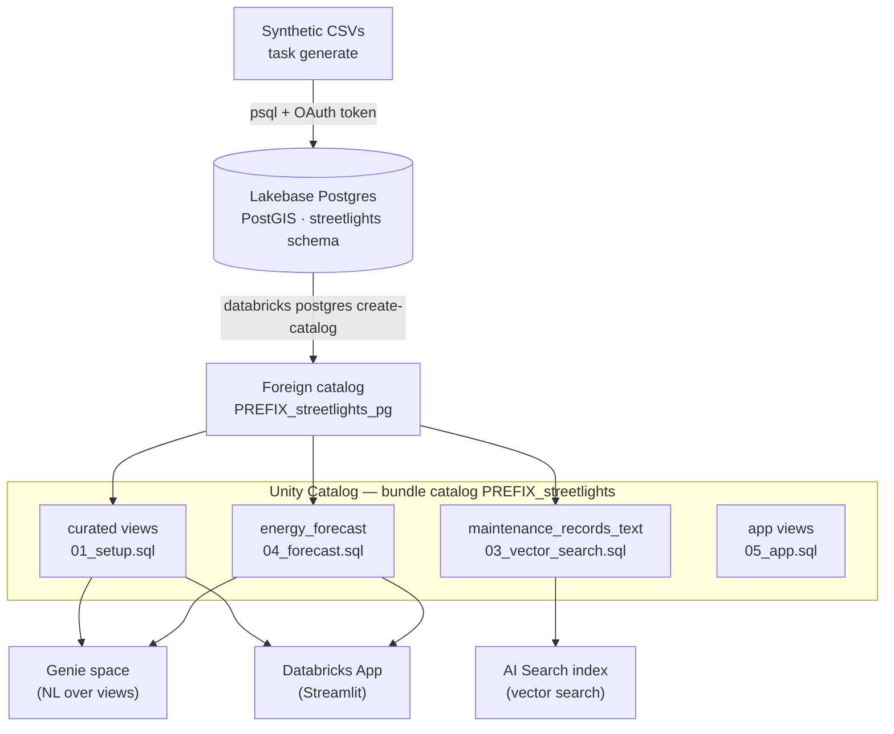

<!-- Copyright 2025 Kamesh Sampath <kamesh.sampath@hotmail.com> -->
<!-- SPDX-License-Identifier: Apache-2.0 -->

# Databricks Implementation Guide — easy start (Lakebase + Genie)

End-to-end walkthrough of the **Databricks path** of the PostGIS Data Intelligence
Demo, written for someone new to Databricks. By the end you will have:

- a **Lakebase** Postgres database with PostGIS and the synthetic streetlights data
- that database registered in **Unity Catalog** (zero-pipeline, like Snowflake's CLD)
- **curated views** in a UC schema (the Genie "semantic layer")
- a **Genie space** answering natural-language questions
- an **AI Search (Vector Search)** index over maintenance text
- an **`ai_forecast()`** energy forecast
- a **Databricks App** (Streamlit) dashboard

**Time required:** ~30–45 minutes (mostly waiting on resource provisioning).

## Architecture



| Snowflake path | This Databricks path |
|---|---|
| Snowflake Postgres + pg_lake | **Lakebase** (real Postgres 16, PostGIS native) |
| CLD (reads Iceberg metadata) | `databricks postgres create-catalog` registers the PG database in UC |
| Semantic View | curated views + Genie space instructions/verified answers |
| Cortex Search | AI Search (Vector Search) Delta Sync index |
| Intelligence Agent | **Genie** space |
| ML FORECAST | `ai_forecast()` on a serverless SQL warehouse |
| Streamlit in Snowflake | Databricks Apps (Streamlit) |

## Prerequisites

- A Databricks workspace with **Unity Catalog** (metastore attached), **Lakebase**,
  **Genie**, and **AI Search** enabled. You need privileges to create catalogs,
  SQL warehouses, and Lakebase projects (ask your workspace admin if unsure).
- Tools: `mise` (tool manager), Databricks CLI, `uv`, `psql`:

```bash
curl https://mise.run | sh        # then restart your shell
cd postgis-data-intelligence-demo
mise install                       # installs python, uv, databricks-cli
mise trust                         # allow mise to use externally installed tools
# snowflake-cli and libpq (psql) are NOT in the mise registry:
#   macOS:  brew install snowflake-cli libpq
#   Ubuntu: see https://docs.snowflake.com/en/developer-guide/snowflake-cli and apt-get install postgresql-client
uv sync
```

- Authenticate the Databricks CLI. Browser OAuth is enough, no PAT needed:

```bash
export DATABRICKS_HOST=https://<your-workspace>.cloud.databricks.com
databricks auth login --host "$DATABRICKS_HOST"     # opens browser, OAuth
# Alternative for headless/CI only: databricks configure --token (paste a PAT from
# Settings > Developer > Access tokens). Never commit the token.
```

- Configure the repo: `cp .env.example .env` and set at least:

```bash
PLATFORM=databricks
DATABRICKS_HOST=https://<your-workspace>.cloud.databricks.com
DATABRICKS_PROFILE=DEFAULT   # browser login (databricks auth login) creates profile DEFAULT
DEMO_PREFIX=PGDEMO        # objects become ${DEMO_PREFIX}_streetlights_*
LAKEBASE_PROJECT=         # filled in at step 2
LAKEBASE_BRANCH=production   # Lakebase creates a default branch named "production"
LAKEBASE_DATABASE=streetlights
DEMO_CITY=Portland
```

> Never commit `.env`. Lakebase credentials are short-lived OAuth tokens
> generated per connection (step 3), not stored anywhere.

**Naming:** Unity Catalog stores all object names as **lowercase**, so on the DBX
path the prefix is the lowercased `DEMO_PREFIX` (your `PGDEMO` becomes `pgdemo`) and
resources are named `${PREFIX}_streetlights*` (e.g. `pgdemo_streetlights`,
`pgdemo_streetlights_pg`, `pgdemo_streetlights_wh`). `.mise.toml` loads `.env`
automatically (`_.file = ".env"`), so put the bundle override there as a lowercase
literal (dotenv values are not shell-expanded, so `BUNDLE_VAR_prefix=$DEMO_PREFIX`
would NOT work):

```bash
# .env:
#   BUNDLE_VAR_prefix=pgdemo        # lowercase literal, applies to bundle deploy AND run
#   ENDPOINT=primary                # the auto-created read-write endpoint
export PREFIX=$(echo "$DEMO_PREFIX" | tr '[:upper:]' '[:lower:]')   # pgdemo, for shell commands below
```

## Running on Databricks Free Edition (formerly Community Edition)

Community Edition was retired on Jan 1, 2026; its successor is **Databricks Free
Edition** (serverless-only, Unity Catalog on by default, daily quota, non-commercial
use). The DBX path of this demo fits within Free Edition quotas:

| Demo component | Free Edition support |
|---|---|
| Unity Catalog (catalog/schema/foreign catalog) | Included by default |
| SQL warehouse | One per account, fixed 2X-Small, serverless. The bundle's `cluster_size: 2X-Small` + `enable_serverless_compute: true` matches; `ai_forecast()` needs serverless, which Free Edition is anyway |
| Jobs (bundle `sql_task` runs) | Up to 5 concurrent tasks; our jobs are single-task and sequential |
| Lakebase | One project with scale-to-zero compute |
| AI Search (Vector Search) | One endpoint (1 search unit) |
| Genie | Included (UI now calls spaces "Genie Agents"; the bundle resource stays `genie_spaces`) |
| Databricks Apps | Up to 3; apps auto-stop after 24h, so re-open/restart the app the next day |

**One workaround required:** Free Edition allows only the pre-created starter
warehouse. Before `databricks bundle deploy`, comment out the
`resources.sql_warehouses` block in `databricks/databricks.yml` and replace every
`${resources.sql_warehouses.streetlights_wh.id}` with your starter warehouse's ID
(SQL Warehouses → starter warehouse → Connection details). Also note the daily
quota: if you hit it, compute pauses until the next day; data and settings are kept.

## Step 1 — Generate the synthetic data

```bash
mise run generate        # uses CITY / STREET_LIGHT_COUNT from .mise.toml [env] (Portland, 5000)
# or explicitly:
uv run generate --city "Portland" --count 5000
# -> data/*.csv (7 tables, git-ignored)
```

The generator default is 2000 lights; we use 5000 for better forecast and search
quality. On Free Edition you can go higher (e.g. 20000); it is still tiny for
serverless compute.

## Step 2 — Create the Lakebase project and compute endpoint

Lakebase resources are managed with the `databricks postgres` CLI group
(check `databricks postgres --help` for exact flags). All commands take
`--profile "$DATABRICKS_PROFILE"` (browser login creates a profile, usually
named `DEFAULT`):

```bash
databricks postgres create-project streetlights-demo --profile "$DATABRICKS_PROFILE" --output json | tee /tmp/lb-project.json
# -> {"name": "projects/streetlights-demo", "project_id": "streetlights-demo",
#     "status": {"default_branch": "projects/streetlights-demo/branches/production", ...}}
#
# The project resource path is projects/<project-name> (e.g. projects/streetlights-demo).
# A default branch "production" is created automatically (pg_version 17), so no
# create-branch call is needed. Save the project name for the steps below.

# create-project already creates a default read-write endpoint with an auto-generated
# ID. Discover it (no create-endpoint call needed in the common case):
databricks postgres list-endpoints projects/streetlights-demo/branches/production \
  --profile "$DATABRICKS_PROFILE" --output json | tee /tmp/lb-endpoints.json
export ENDPOINT=$(jq -r '.[0].endpoint_id // (.[0].name | split("/") | last)' /tmp/lb-endpoints.json)

# Only if you want a dedicated named endpoint instead (ENDPOINT_ID is positional):
# databricks postgres create-endpoint projects/streetlights-demo/branches/production \
#   streetlights-compute --profile "$DATABRICKS_PROFILE" --output json \
#   --json '{"spec": {"endpoint_type": "ENDPOINT_TYPE_READ_WRITE",
#                     "autoscaling_limit_min_cu": 0.5, "autoscaling_limit_max_cu": 4.0}}'
```

(You can also do this in the workspace UI: **Apps → Lakebase Postgres**.
Pick **Autoscaling** compute.) Set `LAKEBASE_PROJECT=streetlights-demo`,
`LAKEBASE_BRANCH=production` in `.env`. The credential/teardown paths below use
`endpoints/$ENDPOINT`.

## Step 3 — Create the schema in Lakebase and load the CSVs

Lakebase speaks the standard Postgres wire protocol. Get a short-lived OAuth
token and connection details (valid 1 hour):

```bash
# (fallback path) raw credential JSON, if you are not using pg_service:
# databricks postgres generate-database-credential \
#   projects/streetlights-demo/branches/production/endpoints/$ENDPOINT \
#   --profile "$DATABRICKS_PROFILE" --output json | tee /tmp/lb-cred.json
# -> {"host": ..., "port": 5432, "database": "databricks_postgres", "token": ...}
# The token expires after 1 hour.
```

Then, with `psql`:

```bash
Preferred: a `pg_service` entry whose password comes from `~/.pgpass` via `passfile`
(repo convention, same as the Snowflake path; no `PGPASSWORD` export needed). The
helper writes both files and refreshes the token (it expires after 1h, so re-run it
whenever psql reports an auth failure):

```bash
mise run lb-cred          # or: bash scripts/lb-service.sh lakebase-demo
# writes ~/.pgpass (chmod 600):  <host>:<port>:<dbname>:<email>:<token>
# and a ~/.pg_service.conf block:  [lakebase-demo] host=... port=5432 dbname=<database
# from the credential JSON, e.g. databricks_postgres> user=<your email> passfile=~/.pgpass

export PGSERVICE=lakebase-demo     # also add PGSERVICE=lakebase-demo to .env

psql "service=$PGSERVICE" -c "SELECT version();"                        # good: PostgreSQL 17.x
psql "service=$PGSERVICE" -f databricks/sql/00_lakebase_schema.sql      # PostGIS + streetlights schema

for table in street_lights maintenance_records energy_consumption light_sensors weather_enrichment demographics power_grid_zones; do
  psql "service=$PGSERVICE" -c "\\copy streetlights.$table FROM 'data/${table}.csv' CSV HEADER"
done

psql "service=$PGSERVICE" -c "SELECT count(*) FROM streetlights.street_lights;"   # good: 5000
```

Fallback (no service file): `databricks postgres generate-database-credential ... | tee /tmp/lb-cred.json`,
then export `PGHOST`/`PGPORT`/`PGDATABASE`/`PGUSER`/`PGPASSWORD` from that JSON and use
plain `psql -h <host> -p 5432 -U <email> -d <database>`. Never commit `~/.pgpass`.
```

## Step 4 — Register the Lakebase database in Unity Catalog (the "CLD equivalent")

```bash
databricks postgres create-catalog ${PREFIX}_streetlights_pg --profile "$DATABRICKS_PROFILE" \
  --json "{\"spec\": {\"postgres_database\": \"$(jq -r .database /tmp/lb-cred.json)\", \
                    \"branch\": \"projects/$LAKEBASE_PROJECT/branches/$LAKEBASE_BRANCH\"}}"
```

The foreign catalog `${PREFIX}_streetlights_pg` now exposes schema `streetlights`
with your 7 tables to any SQL warehouse, Genie, and AI Search — no data copied.

## Step 5 — SQL warehouse, then deploy the asset bundle

- **Paid workspace:** the bundle creates `${PREFIX}_streetlights_wh` (serverless 2X-Small,
  required for `ai_forecast()`), so nothing to do here.
- **Free Edition:** only the pre-created starter warehouse is allowed. Get its ID:

```bash
databricks sql-warehouses list --output json | jq -r '.[] | "\(.id)\t\(.name)\t\(.warehouse_type)\t\(.state)"'
# pick the starter warehouse (2X-Small, serverless), copy its id
```

Then edit `databricks/databricks.yml`: comment out the `resources.sql_warehouses`
block and replace every `${resources.sql_warehouses.streetlights_wh.id}` with that ID:

```bash
sed -i 's/${resources.sql_warehouses.streetlights_wh.id}/<STARTER_WH_ID>/g' databricks/databricks.yml
```

Now validate and deploy (from `databricks/`, or `task dbx:validate` / `task dbx:deploy` from repo root):

```bash
cd databricks
databricks bundle validate -t dev
databricks bundle deploy -t dev
```

This creates: catalog `${PREFIX}_streetlights`, schema `streetlights`, a
**serverless** SQL warehouse `${PREFIX}_streetlights_wh` (serverless is required by
`ai_forecast()`), the AI Search endpoint `${PREFIX}_streetlights_vs`, the **Genie
space** `${PREFIX}_streetlights_genie`, the SQL jobs, and the Databricks App
`${PREFIX}_streetlights_app`. (From the repo root you can use `task dbx:validate` /
`task dbx:deploy`, which run the same commands in `databricks/`.)

## Step 6 — Run the SQL jobs

```bash
task dbx:run-all     # or from databricks/: bundle run setup -> genie_views -> vector_search -> forecast -> app
```

This builds, in `${PREFIX}_streetlights.streetlights`:
- `*_clean` curated views over the Lakebase catalog (`01_setup.sql`)
- verified-question views for Genie (`02_genie_space.sql`)
- `maintenance_records_text` Delta table for vector search (`03_vector_search.sql`)
- `energy_forecast` / `energy_forecast_by_neighborhood` via `ai_forecast()` (`04_forecast.sql`)
- app KPI/map views (`05_app.sql`)

## Step 7 — Create the AI Search index (UI, 2 minutes)

Vector Search indexes are created from the UI or REST API, not SQL:

1. Workspace → **AI Search** → endpoint `${PREFIX}_streetlights_vs` → **Create index**
2. Type: **Delta Sync**; source table:
   `${PREFIX}_streetlights.streetlights.maintenance_records_text`
3. Primary key: `maintenance_id`; embedding source column: `full_text` with
   model `databricks-bge-large-en` (Databricks computes embeddings); sync: TRIGGERED
4. Name: `${PREFIX}_streetlights.streetlights.maintenance_vs_index`

Test it in the SQL editor:

```sql
SELECT * FROM vector_search(
  index => '${PREFIX}_streetlights.streetlights.maintenance_vs_index',
  query_text => 'exposed wires or sparking',
  num_results => 5);
```

## Step 8 — Configure the Genie space (UI, ~5 minutes)

The bundle created the space; now teach it:

1. Workspace → **AI/BI → Genie** → `${PREFIX}_streetlights_genie` → **Edit**
2. **Tables:** add catalog `${PREFIX}_streetlights`, schema `streetlights`
3. **Instructions**, e.g.:

   > You are a streetlights domain expert. Curated views: street_lights_clean,
   > maintenance_records_clean, energy_consumption_clean, weather_enrichment_clean,
   > light_sensors_clean, demographics_clean, power_grid_zones_clean. Join on
   > street_light_id. Statuses: operational | faulty | maintenance_required.
   > For maintenance text questions, use the AI Search index
   > ${PREFIX}_streetlights.streetlights.maintenance_vs_index. When results have
   > latitude/longitude, include a map link:
   > https://www.google.com/maps/search/?api=1&query={lat},{lon}

4. **Verified answers:** add the sample questions from `databricks/sql/02_genie_space.sql`
   (e.g. "How many street lights are currently faulty?" → `SELECT * FROM v_q_faulty_count`)
5. **Sample questions** shown to users, e.g.:
   - "How many street lights are currently faulty?"
   - "Show me faulty lights in Koramangala"
   - "Which neighborhoods have the highest energy consumption?"
   - "What is the average repair cost by maintenance type?"
   - "Predict energy consumption for the next 30 days"
   - "Find maintenance reports about exposed wires or sparking"

Then chat with the space in the Genie UI.

## Step 9 — Open the dashboard app

Workspace → **Apps** → `${PREFIX}_streetlights_app` → open. The app queries the
warehouse via its service principal (the bundle granted `CAN_USE` on
`${PREFIX}_streetlights_wh`). If `DATABRICKS_WAREHOUSE_HTTP_PATH` is not wired,
edit the app's resources to add the warehouse HTTP path
(`/sql/1.0/warehouses/<warehouse-id>`, from **SQL Warehouses →
${PREFIX}_streetlights_wh → Connection details**).

## Step 10 — Validate

```bash
# minimal manifest for the gate tool (git-ignored)
mkdir -p .streetlights-demo
cat > .streetlights-demo/manifest.toml <<EOF
[databricks]
platform = "databricks"
host = "$DATABRICKS_HOST"
catalog_name = "${PREFIX}_streetlights"
schema_name = "streetlights"
lakebase_instance = "projects/$LAKEBASE_PROJECT"

[streetlights-demo]
prefix = "$(echo "$DEMO_PREFIX" | tr '[:upper:]' '[:lower:]')"
EOF

# gate checks for the DBX path — pass --platform databricks so all Snowflake
# paths (snowflake/, snowflake gates/skills) are ignored for the run
uv run gate --step dbx/all --action check --platform databricks
```

And run the sample questions in Genie (step 8).

## Teardown

```bash
task dbx:destroy                                          # bundle resources (app, jobs, Genie space, warehouse, schema, catalog)
databricks postgres delete-catalog ${PREFIX}_streetlights_pg   # unregister the Lakebase DB from UC
databricks postgres delete-endpoint projects/streetlights-demo/branches/production/endpoints/$ENDPOINT --profile "$DATABRICKS_PROFILE"
databricks postgres delete-project projects/streetlights-demo --profile "$DATABRICKS_PROFILE"  # deletes the Lakebase project + data
```

## Troubleshooting

- **`No API found for 'POST /postgres/projects/<p>/branches/endpoints'`**: the branch
  segment of the resource path is empty, usually because the wrong env var was used
  (`$LAKEHOUSE_BRANCH`) or `.env` was not sourced. Run `set -a; source .env; set +a`
  and check `echo "projects/$LAKEBASE_PROJECT/branches/$LAKEBASE_BRANCH"` prints
  `projects/streetlights-demo/branches/production`.
- **`databricks bundle validate` fails on `${var...}`**: you're editing SQL outside
  the bundle — DAB interpolates `${var.prefix}` only inside bundle files. Fine.
- **ai_forecast error "requires serverless"**: the bundle warehouse must have
  `enable_serverless_compute: true` (it does); if you created a classic warehouse
  manually, recreate it as serverless.
- **Foreign catalog shows no tables**: the Lakebase compute (endpoint) must be
  running; check `databricks postgres list-endpoints`. Refresh the catalog in
  the UI — syncs trigger automatically but the UI caches.
- **psql connection refused / token expired**: OAuth tokens last 1 hour —
  regenerate with `generate-database-credential` (step 3).
- **Genie answers poorly**: add more verified answers and precise instructions;
  point it explicitly at the `*_clean` views.
- **Vector index empty**: ensure the `vector_search` job ran (the
  `maintenance_records_text` table exists) before creating the index.

## Links

- Lakebase: https://docs.databricks.com/en/oltp/
- `databricks postgres` CLI: https://docs.databricks.com/en/dev-tools/cli/reference/postgres-commands
- Register a Lakebase DB in UC: https://docs.databricks.com/en/oltp/instances/register-uc
- Asset Bundles: https://docs.databricks.com/en/dev-tools/bundles/
- Genie: https://docs.databricks.com/en/genie/
- AI Search / Vector Search: https://docs.databricks.com/en/vector-search/
- `ai_forecast()`: https://docs.databricks.com/en/sql/language-manual/functions/ai_forecast
- Databricks Apps: https://docs.databricks.com/en/dev-tools/databricks-apps/
