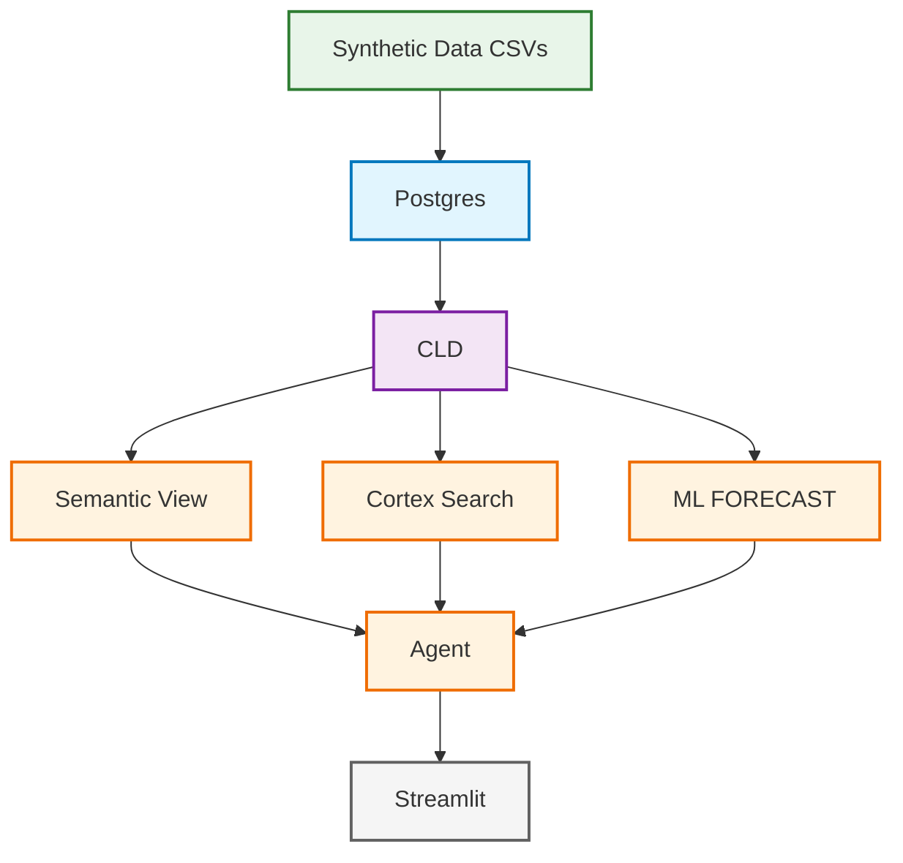
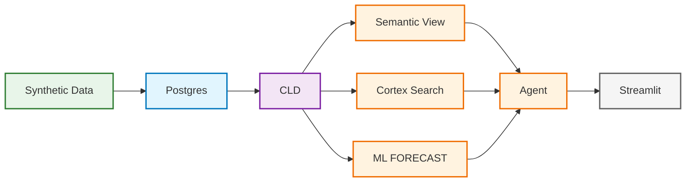

<!-- Copyright 2025 Kamesh Sampath <kamesh.sampath@gmail.com> -->
<!-- SPDX-License-Identifier: Apache-2.0 -->

# Snowflake Implementation Guide

This guide documents the Snowflake implementation of the PostGIS Data Intelligence Demo. It covers architecture, setup, and execution.

## Quickstart

For a fast start without Cortex Code skills:

```bash
# 1. Install mise
curl https://mise.run | sh

# 2. Clone the repository
cd postgis-data-intelligence-demo

# 3. Install tools and copy environment
mise install
cp .env.example .env
# Edit .env with your Snowflake and PostgreSQL settings (PGSERVICE, SNOWFLAKE_CONNECTION, ...)

# 4. Install additional CLI tools
# Snowflake CLI: brew install snowflake-cli (macOS)
# PostgreSQL CLI: brew install libpq (macOS) or sudo apt-get install postgresql-client (Ubuntu)
mise trust

# 5. Run setup (Taskfile tasks handle the psql service lookup from the manifest)
task generate -- --city "Portland" --prefix "DEMO"
task pg:schema
task pg:load
task sf:setup
task sf:semantic-view
task sf:search
task sf:agent
task sf:forecast
```

The Streamlit-in-Snowflake app (`app/`) is deployed in guided step 9
(`$streetlights-demo step 9`) via `app/snowflake.yml`.

This completes the Snowflake implementation end-to-end.

**Time required:** ~15-20 minutes

## Architecture

### Core Components



### Data Flow



### Key Insight: Zero Data Movement

The Catalog-Linked Database (CLD) reads PostgreSQL Iceberg metadata directly. No CDC pipeline, no ETL, no data duplication.

## Prerequisites

### Account Requirements

Your Snowflake account must have these parameters enabled:

- `ENABLE_SNOWFLAKE_POSTGRES`
- `ENABLE_POSTGRES_HIDDEN_EXTERNAL_VOLUME`

Verify with:

```sql
SHOW PARAMETERS LIKE 'ENABLE_SNOWFLAKE_POSTGRES' IN ACCOUNT;
SHOW PARAMETERS LIKE 'ENABLE_POSTGRES_HIDDEN_EXTERNAL_VOLUME' IN ACCOUNT;
```

### Tools & CLI Configuration

| Tool | Purpose | Installation |
|------|---------|--------------|
| **mise** | Tool version manager | `curl https://mise.run | sh` |
| Snowflake CLI | Manage resources, run SQL | `brew install snowflake-cli` |
| PostgreSQL CLI | Connect to Snowflake Postgres | `brew install libpq` |
| UV | Python package manager | `mise install uv` |

## Required Steps

### Step 0: Project Setup

```bash
cd postgis-data-intelligence-demo
mise install
```

### Step 1: Generate Synthetic Data

```bash
# For Portland (default)
uv run generate

# For a specific city
uv run generate --city "San Francisco" --lat 37.7749 --lng -122.4194 --count 1000

# With demo prefix
uv run generate --prefix "DEMO" --city "Boston" --lat 42.3601 --lng -71.0589
```

Output: 8 CSV files in `data/` directory.

### Step 2: Create Snowflake Postgres Instance

Create the instance via the guided skill (`$streetlights-demo step 2`) or the
Snowflake CLI/UI. It needs pg_lake (Iceberg storage) + postgis + managed storage.

### Step 3: Create Iceberg Tables & Load Data

```bash
# psql always connects via the named service from ~/.pg_service.conf
psql "service=$PGSERVICE" -f init/01_enable_extensions.sql
psql "service=$PGSERVICE" -f init/02_create_iceberg_tables.sql

for table in street_lights maintenance_records energy_consumption light_sensors weather_enrichment demographics power_grid_zones; do
  psql "service=$PGSERVICE" -c "\\copy streetlights.$table FROM 'data/${table}.csv' CSV HEADER"
done
# or simply: task pg:schema && task pg:load
```

> **Note**
> The `-D` flag for templating uses ` <% PREFIX %>` syntax (STANDARD templating).
> Always use uppercase: `-D "PREFIX=DEMO"` even if manifest uses lowercase.

### Step 4: Create Catalog-Linked Database

```bash
snow sql -f snowflake/01_setup.sql
```

This creates the CLD that reads Iceberg metadata from Snowflake Postgres managed storage.

### Step 5: Create Semantic View

```bash
snow sql -f snowflake/02_semantic_view.sql
```

Creates semantic layer for natural language queries.

> **Important**
> CLD columns have lowercase names from PostgreSQL. Always double-quote: `"light_id"`, `"date"`, `"status"`, `"kwh"`.

### Step 6: Create Cortex Search Service

```bash
snow sql -f snowflake/03_cortex_search.sql
```

Creates search index on maintenance records.

### Step 7: Create Intelligence Agent

```bash
snow sql -f snowflake/04_intelligence_agent.sql
```

Creates the natural language agent with Semantic View + Search routing.

> **Note**
> The Intelligence Agent is fully operational at this point. You can query it directly in Snowflake Intelligence.

### Step 8: Train ML Forecast Model

```bash
snow sql -f snowflake/05_ml_forecast.sql
```

Trains time-series forecasting on energy consumption.

### Step 9: Deploy Streamlit App

Deploy the multi-page dashboard from `app/` (Streamlit in Snowflake) via
guided step 9 (`$streetlights-demo step 9`, uses `app/snowflake.yml`) or
`snow streamlit deploy` from the `app/` directory.

### Step 10: Validation

```bash
uv run gate --all
```

Runs all gate checks to validate the complete implementation.

## Guided Setup

For a guided experience, use the Cortex Code skill:

> **Tip**
> In Cortex Code, use: `$streetlights-demo setup` to begin the guided workflow.

The skill provides:
- Interactive prompts for configuration
- Step-by-step validation
- Automatic rollback on errors
- Intent-driven development tracking

## Troubleshooting

### Common Issues

**Snowflake Postgres not available:**
- Verify `ENABLE_SNOWFLAKE_POSTGRES` is enabled on your account
- Use Snowflake Classic Console (not new Console) for Postgres features

**CLD not syncing:**
- Verify pg_lake extension is enabled
- Check managed storage external volume is created
- Confirm Iceberg metadata is visible in Unity Catalog

**Permission errors:**
- Ensure your role has CREATE privileges on the database/schema
- Verify ownership of PostgreSQL instance

## Links

- [Snowflake Documentation](https://docs.snowflake.com)
- [pg_lake Documentation](https://docs.snowflake.com/en/developer-guide/iceberg-tables/iceberg-pg-lake)
- [Snowflake Postgres Documentation](https://docs.snowflake.com/en/user-guide/postgres)
